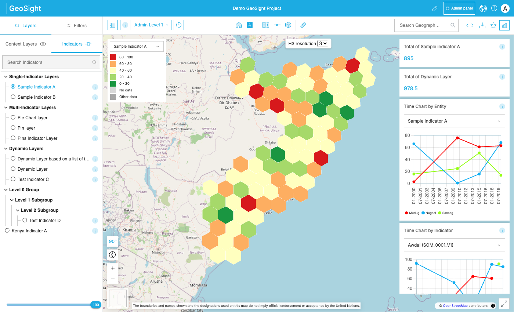
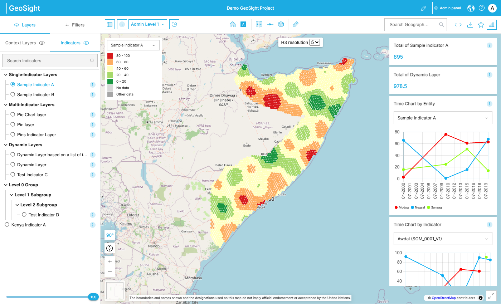

# H3 map layer

How the project map adds layers, and how `H3IndicatorLayer` draws hexagons from H3 IDs.

## 1. How the map adds layers today

All paths are under `django_project/frontend/src/pages/Dashboard/MapLibre/`.

- **Map:** [`MapLibre.tsx`](../../django_project/frontend/src/pages/Dashboard/MapLibre/MapLibre.tsx)
  - `_MapLibre` creates the MapLibre map, plus one deck.gl `MapboxOverlay` (`interleaved: true`).
  - `MainMapLibre` (and `MirrorMapLibre` for side-by-side mode) render the layer components as siblings: `<ContextLayers>`, `<ReferenceLayers>`, and now `<H3IndicatorLayer>`. Each layer component gets the `map` and adds its own sources/layers. None of them render HTML.
- **Indicator layers:** `Layers/ReferenceLayer/index.tsx`
  - Boundaries are vector tiles drawn as a MapLibre `fill` layer.
  - Values are colored with a `case` expression keyed on `ucode` / `concept_uuid`.
  - The 3D view uses the shared deck.gl overlay and calls `deckgl.setProps({ layers: [...] })`, which **replaces every layer on that overlay**.
- **Colors:** `UpdateStyleData(rows, config)` in `utils/indicatorData.jsx` attaches a `style` (with `color`) to each `{value, admin_level}` row, using the config from `returnLayerStyleConfig` (`utils/Style.js`).
- **Popups:** `addPopup` in `utils/index.js` finds the clicked feature with MapLibre's `queryRenderedFeatures`, then opens one shared popup.

## 2. H3IndicatorLayer

Folder: `Layers/H3IndicatorLayer/` (`index.tsx`, `mock.js`, `mock.json`)

- **Data:** person A's API.
  - `GET /api/v1/indicators/<id>/h3/resolutions/` returns e.g. `[5, 7]`.
  - `GET /api/v1/indicators/<id>/h3/values/?resolution=N` returns `[{geom_id, value}]` for the latest date.
- **Draws** with deck.gl `H3HexagonLayer` (already in `deck.gl` 8.8, so `package.json` didn't change).
- **Colors** come from the same `UpdateStyleData` + `returnLayerStyleConfig` as region polygons, so hexagons match the legend. The resolution is passed in as `admin_level` (needed for dynamic styles).
- **Click** shows `H3 ID` and `Value`.
- **Resolution picker** at the top of the map, shown only when there are 2 or more resolutions.
- **No H3 data → nothing changes.** Only `/h3/resolutions/` is called, it returns `[]`, and the component adds no layers and no UI.
- **Mock:** add `?h3_mock=1` to the project URL to use `mock.json` (resolutions 5 and 7 around Mogadishu), or `?h3_mock=10000` to generate 10,000 cells.

**Gotchas I hit:**
1. **Own overlay:** the hexagons need their **own** deck.gl overlay. On the shared one, `ReferenceLayer`'s `setProps` would wipe them out.
2. **Clicks:** deck.gl's `onClick` didn't work. The popup closed immediately, and region popups (found via `queryRenderedFeatures`) can't see deck.gl layers. Instead, the component listens to MapLibre's `click`, picks the hexagon with `deckgl.pickObject`, and opens the popup with GeoSight's `addStandalonePopup` on the next tick, so it replaces the region popup.

**Not done yet:**
- Uses the latest date; it doesn't follow the time slider.
- Shows only the first layer in compare mode.
- The region polygons still draw underneath.

## 3. Demo project screenshots

I filled Somalia's outline with test hexagons for "Sample Indicator A" in my local database, at resolutions 3, 4, 5 and 6, with made-up values. These screenshots load through the real API.

| Resolution 3 (92 cells) | Resolution 5 (~3,100 cells) |
|---|---|
|  |  |

## 4. Performance

I used `?h3_mock=N` with headless Chromium on my MacBook (Apple Silicon GPU) and dragged the map for about 4 s.

| Hexagons | Panning FPS | Slowest frame | Longest freeze while loading |
|---|---|---|---|
| none (normal project) | 60 | 17 ms | 0.6 s |
| 1,000 | 60 | 17 ms | 0.6 s |
| 10,000 | 60 | 17 ms | 0.6 s |
| 50,000 | 60 | 17 ms | 1.5 s |
| 100,000 | 60 | 17 ms | 3.1 s |
| 200,000 | 60 | 17 ms | 5.9 s |

- **Panning never lagged,** even at 200,000 hexagons. The GPU handles drawing easily.
- **The slow part is loading.** From about 50,000 cells, the page freezes for over a second while every cell is colored. `UpdateStyleData` runs `eval` on the style rules for every cell. In mock mode, generating the cells also adds some time.
- **For large data:** color by value range instead of `eval`, or move coloring to a web worker. Also check on a slower laptop; these numbers are from a fast GPU.
