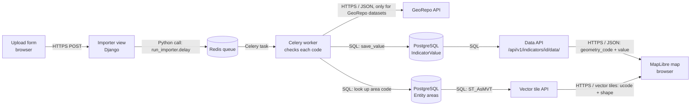

# Codebase Map: How one indicator value moves through GeoSight

The question: how does a number like "42 schools" get uploaded, checked, saved in the database, and sent to the browser? And where does GeoSight assume that a number belongs to a district?

All links point to commit [516c4db](https://github.com/callie-yuan/t4sg-unicef-h3/tree/516c4db786d48336f35694f975758ccb4cd7b204) on h3-dev.

## 1. Trace how one indicator number gets into GeoSight and back out

### a. Storage

Running `grep -rn "class Indicator" django_project/` leads to the model `IndicatorValue`. One row of this model is one value (one number, for one place, on one date).
[indicator_value.py L29-L151](https://github.com/callie-yuan/t4sg-unicef-h3/blob/516c4db786d48336f35694f975758ccb4cd7b204/django_project/geosight/data/models/indicator/indicator_value.py#L29-L151)

Its foreign keys:
- `indicator` points to `Indicator`, which is what is being measured ([L49-L51](https://github.com/callie-yuan/t4sg-unicef-h3/blob/516c4db786d48336f35694f975758ccb4cd7b204/django_project/geosight/data/models/indicator/indicator_value.py#L49-L51))
- `entity` points to `Entity`, which is the area the value belongs to ([L62-L65](https://github.com/callie-yuan/t4sg-unicef-h3/blob/516c4db786d48336f35694f975758ccb4cd7b204/django_project/geosight/data/models/indicator/indicator_value.py#L62-L65))
- `country` also points to `Entity`, which is the country of that area ([L67-L73](https://github.com/callie-yuan/t4sg-unicef-h3/blob/516c4db786d48336f35694f975758ccb4cd7b204/django_project/geosight/data/models/indicator/indicator_value.py#L67-L73))

`Entity` stores the area itself: its code (`geom_id`), its shape (`geometry`), its admin level, and its parents ([entity.py L50-L130](https://github.com/callie-yuan/t4sg-unicef-h3/blob/516c4db786d48336f35694f975758ccb4cd7b204/django_project/geosight/georepo/models/entity.py#L50-L130)).

Fields that say where a value applies:
- `geom_id`: the area code. The help text says "This is ucode from georepo." ([L45-L48](https://github.com/callie-yuan/t4sg-unicef-h3/blob/516c4db786d48336f35694f975758ccb4cd7b204/django_project/geosight/data/models/indicator/indicator_value.py#L45-L48))
- `entity`, `entity_name`, `admin_level`, `concept_uuid`: copied from the matching area ([L96-L103](https://github.com/callie-yuan/t4sg-unicef-h3/blob/516c4db786d48336f35694f975758ccb4cd7b204/django_project/geosight/data/models/indicator/indicator_value.py#L96-L103))
- `country`, `country_name`, `country_geom_id`, `country_concept_uuid`: the country of that area ([L113-L127](https://github.com/callie-yuan/t4sg-unicef-h3/blob/516c4db786d48336f35694f975758ccb4cd7b204/django_project/geosight/data/models/indicator/indicator_value.py#L113-L127))

Fields that say when a value applies:
- `date`: the date of the value ([L35-L38](https://github.com/callie-yuan/t4sg-unicef-h3/blob/516c4db786d48336f35694f975758ccb4cd7b204/django_project/geosight/data/models/indicator/indicator_value.py#L35-L38))
- `entity_start_date`, `entity_end_date`: when that version of the boundary was valid ([L104-L109](https://github.com/callie-yuan/t4sg-unicef-h3/blob/516c4db786d48336f35694f975758ccb4cd7b204/django_project/geosight/data/models/indicator/indicator_value.py#L104-L109))

There can only be one value per indicator, date and area code ([L129-L130](https://github.com/callie-yuan/t4sg-unicef-h3/blob/516c4db786d48336f35694f975758ccb4cd7b204/django_project/geosight/data/models/indicator/indicator_value.py#L129-L130)).

### b. Import

1. The admin submits the upload form. The view saves the importer and calls `post_saved()` ([form.py L122](https://github.com/callie-yuan/t4sg-unicef-h3/blob/516c4db786d48336f35694f975758ccb4cd7b204/django_project/frontend/views/admin/importer/form.py#L122)).
2. `post_saved()` starts a Celery background task, `run_importer` ([importer.py L319-L324](https://github.com/callie-yuan/t4sg-unicef-h3/blob/516c4db786d48336f35694f975758ccb4cd7b204/django_project/geosight/importer/models/importer.py#L319-L324)), which runs the importer ([tasks.py L27-L40](https://github.com/callie-yuan/t4sg-unicef-h3/blob/516c4db786d48336f35694f975758ccb4cd7b204/django_project/geosight/importer/tasks.py#L27-L40)).
3. The importer reads the area code from the column the admin picked ([L110](https://github.com/callie-yuan/t4sg-unicef-h3/blob/516c4db786d48336f35694f975758ccb4cd7b204/django_project/geosight/importer/importers/base/indicator_value_long_format.py#L110), [L136](https://github.com/callie-yuan/t4sg-unicef-h3/blob/516c4db786d48336f35694f975758ccb4cd7b204/django_project/geosight/importer/importers/base/indicator_value_long_format.py#L136)).
4. This is where the location code is checked. Each row's code is looked up with `get_entity` ([L181-L198](https://github.com/callie-yuan/t4sg-unicef-h3/blob/516c4db786d48336f35694f975758ccb4cd7b204/django_project/geosight/importer/importers/base/indicator_value_long_format.py#L181-L198)):
   - `Entity.get_entity` searches the areas of the chosen reference dataset for that code and date, and rejects the code if the admin level doesn't match ([entity.py L137-L218](https://github.com/callie-yuan/t4sg-unicef-h3/blob/516c4db786d48336f35694f975758ccb4cd7b204/django_project/geosight/georepo/models/entity.py#L137-L218)).
   - Codes that aren't found are sent to the GeoRepo API, but only if the dataset comes from GeoRepo ([L419-L447](https://github.com/callie-yuan/t4sg-unicef-h3/blob/516c4db786d48336f35694f975758ccb4cd7b204/django_project/geosight/importer/importers/base/indicator_value.py#L419-L447)). If the code is still not found, the row gets the error "This code does not exist." ([L215-L242](https://github.com/callie-yuan/t4sg-unicef-h3/blob/516c4db786d48336f35694f975758ccb4cd7b204/django_project/geosight/importer/importers/base/indicator_value_long_format.py#L215-L242)).
5. Rows that pass are saved with `indicator.save_value(...)` ([L467-L512](https://github.com/callie-yuan/t4sg-unicef-h3/blob/516c4db786d48336f35694f975758ccb4cd7b204/django_project/geosight/importer/importers/base/indicator_value.py#L467-L512)).
6. This is the code that writes the row. `save_value` looks up the area again, then runs `IndicatorValue.objects.get_or_create(indicator, date, geom_id)` and links the area and country to the value ([indicator.py L348-L374](https://github.com/callie-yuan/t4sg-unicef-h3/blob/516c4db786d48336f35694f975758ccb4cd7b204/django_project/geosight/data/models/indicator/indicator.py#L348-L374), [indicator_value.py L203-L245](https://github.com/callie-yuan/t4sg-unicef-h3/blob/516c4db786d48336f35694f975758ccb4cd7b204/django_project/geosight/data/models/indicator/indicator_value.py#L203-L245)).

### c. Serve

When the map shows an indicator layer, the frontend calls `GET /api/v1/indicators/<id>/data/`:
- Frontend: the URL is built in [Indicator.tsx L37](https://github.com/callie-yuan/t4sg-unicef-h3/blob/516c4db786d48336f35694f975758ccb4cd7b204/django_project/frontend/src/class/Indicator.tsx#L37), and the latest value per area is requested in [L41-L74](https://github.com/callie-yuan/t4sg-unicef-h3/blob/516c4db786d48336f35694f975758ccb4cd7b204/django_project/frontend/src/class/Indicator.tsx#L41-L74)
- URL route: [urls_v1.py L74-L79](https://github.com/callie-yuan/t4sg-unicef-h3/blob/516c4db786d48336f35694f975758ccb4cd7b204/django_project/geosight/data/urls_v1.py#L74-L79)
- View: `IndicatorDataViewSet` returns the values of that indicator ([data.py L95-L146](https://github.com/callie-yuan/t4sg-unicef-h3/blob/516c4db786d48336f35694f975758ccb4cd7b204/django_project/geosight/data/api/v1/indicator/data.py#L95-L146))
- Serializer: `geometry_code` in the response is just `geom_id` ([indicator_value.py L39-L41](https://github.com/callie-yuan/t4sg-unicef-h3/blob/516c4db786d48336f35694f975758ccb4cd7b204/django_project/geosight/data/serializer/indicator_value.py#L39-L41))

The area shapes come from a separate request for vector tiles, `/reference-dataset/reference-datasets/<dataset id>/vector-tiles/{z}/{x}/{y}/`. The tiles are built in SQL, each area's `geom_id` is put in the tile as `ucode`, and there is one tile layer per admin level (`Level-0`, `Level-1`, `Level-2`) ([vector_tile.py L26-L51](https://github.com/callie-yuan/t4sg-unicef-h3/blob/516c4db786d48336f35694f975758ccb4cd7b204/django_project/geosight/reference_dataset/utils/vector_tile.py#L26-L51)).

Real response, from the browser on my local GeoSight (Demo GeoSight Project, Sample Indicator A, Admin Level 2), trimmed to 3 rows:

```
GET /api/v1/indicators/318/data/?date__lte=2026-02-28&version=1791779873-00000000-0000-0000-0000-000000000000-1704070861&admin_level=2&page_size=500&country_concept_uuid__in=a2006979-4f25-448c-891b-3935c4bcf6f0&date__gte=2000-01-01&fields=geometry_code,value,concept_uuid,admin_level,date,time&distinct=geom_id&sort=geom_id,-date&page=1
```
```json
{
  "next": null, "previous": null, "count": 74, "page": 1, "total_page": 1, "page_size": 500,
  "results": [
    {"geometry_code": "SOM_0001_0001_V1", "value": 1.0,  "time": 1577836800.0, "date": "2020-01-01", "admin_level": 2, "concept_uuid": "998e50ae-d1c4-48fa-8357-4dcbe3574517"},
    {"geometry_code": "SOM_0001_0002_V1", "value": 51.0, "time": 1577836800.0, "date": "2020-01-01", "admin_level": 2, "concept_uuid": "b1d27efa-bfc2-4a93-99da-cac93faba80b"},
    {"geometry_code": "SOM_0001_0003_V1", "value": 91.0, "time": 1577836800.0, "date": "2020-01-01", "admin_level": 2, "concept_uuid": "6bddaec7-83a1-4da5-9d37-8a32bc925e64"}
  ]
}
```

### d. Join key

The field that links a value to a boundary shape is `geom_id` (the area code). In the API it is called `geometry_code`, and in the vector tiles it is called `ucode`. The map colors a shape when its `ucode` is in the list of codes for a color ([ReferenceLayer/index.tsx L614-L633](https://github.com/callie-yuan/t4sg-unicef-h3/blob/516c4db786d48336f35694f975758ccb4cd7b204/django_project/frontend/src/pages/Dashboard/MapLibre/Layers/ReferenceLayer/index.tsx#L614-L633)). If a project is set to use concept UUIDs, it matches on `concept_uuid` instead ([L202-L204](https://github.com/callie-yuan/t4sg-unicef-h3/blob/516c4db786d48336f35694f975758ccb4cd7b204/django_project/frontend/src/pages/Dashboard/MapLibre/Layers/ReferenceLayer/index.tsx#L202-L204)).

I checked this on my local GeoSight. All 43 district codes in one map tile over Somalia (`vector-tiles/5/20/15/`) are also in the `geometry_code` values from the API above.

## 2. Diagram: upload → storage → API → browser

### a. Tool

I made the diagram with Mermaid instead of draw.io, because GitHub draws it directly from this file.



## 3. Assumptions table

| File:line | What it assumes | What breaks if the location is an H3 cell |
|---|---|---|
| [indicator_value.py:45-48](https://github.com/callie-yuan/t4sg-unicef-h3/blob/516c4db786d48336f35694f975758ccb4cd7b204/django_project/geosight/data/models/indicator/indicator_value.py#L45-L48), [:129-130](https://github.com/callie-yuan/t4sg-unicef-h3/blob/516c4db786d48336f35694f975758ccb4cd7b204/django_project/geosight/data/models/indicator/indicator_value.py#L129-L130) | `geom_id` is a GeoRepo area code, and there is one value per indicator, date and code | An H3 ID could fit in the field, but nothing says it is H3 or what resolution it is |
| [entity.py:137-218](https://github.com/callie-yuan/t4sg-unicef-h3/blob/516c4db786d48336f35694f975758ccb4cd7b204/django_project/geosight/georepo/models/entity.py#L137-L218), [indicator.py:348-359](https://github.com/callie-yuan/t4sg-unicef-h3/blob/516c4db786d48336f35694f975758ccb4cd7b204/django_project/geosight/data/models/indicator/indicator.py#L348-L359) | Every code must be a known area in the reference dataset (or in GeoRepo) before the value is saved | H3 cells are not areas, so every row gets "This code does not exist." and nothing is saved |
| [long_format.py:171-179](https://github.com/callie-yuan/t4sg-unicef-h3/blob/516c4db786d48336f35694f975758ccb4cd7b204/django_project/geosight/importer/importers/base/indicator_value_long_format.py#L171-L179), [entity.py:214-217](https://github.com/callie-yuan/t4sg-unicef-h3/blob/516c4db786d48336f35694f975758ccb4cd7b204/django_project/geosight/georepo/models/entity.py#L214-L217) | Every row has an admin level, and it must match the area's level | H3 has resolutions (0-15), not admin levels, so rows fail "Admin level is required" or the level doesn't match |
| [indicator_value.py:225-245](https://github.com/callie-yuan/t4sg-unicef-h3/blob/516c4db786d48336f35694f975758ccb4cd7b204/django_project/geosight/data/models/indicator/indicator_value.py#L225-L245), [Indicator.tsx:59-74](https://github.com/callie-yuan/t4sg-unicef-h3/blob/516c4db786d48336f35694f975758ccb4cd7b204/django_project/frontend/src/class/Indicator.tsx#L59-L74) | Each value belongs to one country (from the area's parents), and the map filters values by country | A hexagon can cross a border and has no country, so it would be filtered out of the map request |
| [vector_tile.py:26-51](https://github.com/callie-yuan/t4sg-unicef-h3/blob/516c4db786d48336f35694f975758ccb4cd7b204/django_project/geosight/reference_dataset/utils/vector_tile.py#L26-L51) | Shapes come from stored area boundaries, with one tile layer per admin level | There are no hexagon shapes stored, so there is nothing to draw and color |
| [ReferenceLayer/index.tsx:614-633](https://github.com/callie-yuan/t4sg-unicef-h3/blob/516c4db786d48336f35694f975758ccb4cd7b204/django_project/frontend/src/pages/Dashboard/MapLibre/Layers/ReferenceLayer/index.tsx#L614-L633) | Each shape on the map has a `ucode` to match against the values | Hexagon shapes would need their H3 ID in `ucode`, or nothing gets colored |

## 4. Open questions for UNICEF

1. Should H3 values be stored in the same `IndicatorValue` table (with the H3 ID as `geom_id`), or in a separate table?
2. Which H3 resolutions do you need?
3. Will the data come as latitude/longitude points that we convert to cells, or already as H3 IDs?
4. Do H3 values need to belong to a country? If yes, what should happen to cells that cross a border?
5. Can we use the `h3-pg` extension on your PostgreSQL database?
