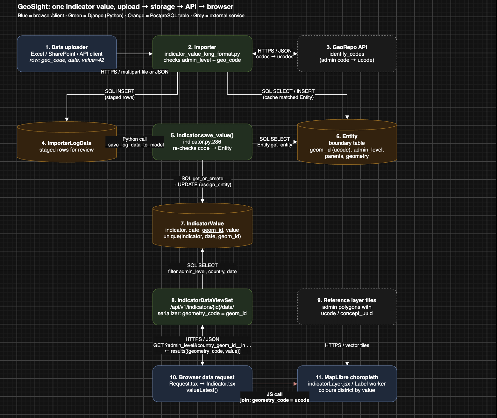

# Value Path: How One Indicator Number Moves Through GeoSight

Example question: how does a number like "42 schools" get uploaded, validated, stored, and sent to the browser?

All permalinks point at commit `516c4db` on `origin/h3-dev`.

## 1. Tracing one indicator value

### 1a. Storage

**Model:** `IndicatorValue`, `[indicator_value.py#L29-L30](https://github.com/callie-yuan/t4sg-unicef-h3/blob/516c4db786d48336f35694f975758ccb4cd7b204/django_project/geosight/data/models/indicator/indicator_value.py#L29-L30)`. One row = one number for one indicator, at one place, on one date.

Following the foreign keys:

- `indicator` → `Indicator`: *what* is being measured.
- `entity` and `country` → `Entity` (`[entity.py#L50-L118](https://github.com/callie-yuan/t4sg-unicef-h3/blob/516c4db786d48336f35694f975758ccb4cd7b204/django_project/geosight/georepo/models/entity.py#L50-L118)`): the boundary table. It has one row per admin boundary, with its polygon, admin level, parents and validity dates.

**Fields on** `IndicatorValue` **that say *where* or *when* a value applies:**


| Field                   | Where / When | Required? | Permalink                                                                                                                                                                           | Notes                                                                      |
| ----------------------- | ------------ | --------- | ----------------------------------------------------------------------------------------------------------------------------------------------------------------------------------- | -------------------------------------------------------------------------- |
| `date`                  | When         | Yes       | [L35-L38](https://github.com/callie-yuan/t4sg-unicef-h3/blob/516c4db786d48336f35694f975758ccb4cd7b204/django_project/geosight/data/models/indicator/indicator_value.py#L35-L38)     | Date the value applies to                                                  |
| `geom_id`               | Where        | Yes       | [L45-L48](https://github.com/callie-yuan/t4sg-unicef-h3/blob/516c4db786d48336f35694f975758ccb4cd7b204/django_project/geosight/data/models/indicator/indicator_value.py#L45-L48)     | `help_text='This is ucode from georepo.'` The only required location field |
| `entity` (FK → Entity)  | Where        | No (auto) | [L62-L66](https://github.com/callie-yuan/t4sg-unicef-h3/blob/516c4db786d48336f35694f975758ccb4cd7b204/django_project/geosight/data/models/indicator/indicator_value.py#L62-L66)     | Filled by `assign_entity()` by looking up `geom_id`                        |
| `country` (FK → Entity) | Where        | No (auto) | [L67-L73](https://github.com/callie-yuan/t4sg-unicef-h3/blob/516c4db786d48336f35694f975758ccb4cd7b204/django_project/geosight/data/models/indicator/indicator_value.py#L67-L73)     | The admin-0 entity that contains this value                                |
| `entity_name`           | Where        | No (auto) | [L92-L95](https://github.com/callie-yuan/t4sg-unicef-h3/blob/516c4db786d48336f35694f975758ccb4cd7b204/django_project/geosight/data/models/indicator/indicator_value.py#L92-L95)     | Copied from Entity                                                         |
| `admin_level`           | Where        | No (auto) | [L96-L98](https://github.com/callie-yuan/t4sg-unicef-h3/blob/516c4db786d48336f35694f975758ccb4cd7b204/django_project/geosight/data/models/indicator/indicator_value.py#L96-L98)     | Integer admin level (0 = country)                                          |
| `concept_uuid`          | Where        | No (auto) | [L99-L103](https://github.com/callie-yuan/t4sg-unicef-h3/blob/516c4db786d48336f35694f975758ccb4cd7b204/django_project/geosight/data/models/indicator/indicator_value.py#L99-L103)   | GeoRepo ID that stays stable across boundary versions                      |
| `entity_start_date`     | When         | No (auto) | [L104-L106](https://github.com/callie-yuan/t4sg-unicef-h3/blob/516c4db786d48336f35694f975758ccb4cd7b204/django_project/geosight/data/models/indicator/indicator_value.py#L104-L106) | When this boundary *version* became valid                                  |
| `entity_end_date`       | When         | No (auto) | [L107-L109](https://github.com/callie-yuan/t4sg-unicef-h3/blob/516c4db786d48336f35694f975758ccb4cd7b204/django_project/geosight/data/models/indicator/indicator_value.py#L107-L109) | When this boundary version stopped being valid                             |
| `country_name`          | Where        | No (auto) | [L113-L116](https://github.com/callie-yuan/t4sg-unicef-h3/blob/516c4db786d48336f35694f975758ccb4cd7b204/django_project/geosight/data/models/indicator/indicator_value.py#L113-L116) |                                                                            |
| `country_geom_id`       | Where        | No (auto) | [L117-L121](https://github.com/callie-yuan/t4sg-unicef-h3/blob/516c4db786d48336f35694f975758ccb4cd7b204/django_project/geosight/data/models/indicator/indicator_value.py#L117-L121) | Country ucode; the frontend filters on this                                |
| `country_concept_uuid`  | Where        | No (auto) | [L122-L127](https://github.com/callie-yuan/t4sg-unicef-h3/blob/516c4db786d48336f35694f975758ccb4cd7b204/django_project/geosight/data/models/indicator/indicator_value.py#L122-L127) | Indexed                                                                    |


**Constraints and indexes** ([L129-L151](https://github.com/callie-yuan/t4sg-unicef-h3/blob/516c4db786d48336f35694f975758ccb4cd7b204/django_project/geosight/data/models/indicator/indicator_value.py#L129-L151)):

- `unique_together = ('indicator', 'date', 'geom_id')` means at most one value per indicator, per location, per date.
- Indexes on `geom_id`, `(indicator, entity)`, `(indicator, country_id, admin_level)`, `(indicator, admin_level)` and others. Every lookup path assumes an admin-boundary hierarchy.

**How the auto fields get filled:** `assign_entity()` / `assign_country()`, [L203-L245](https://github.com/callie-yuan/t4sg-unicef-h3/blob/516c4db786d48336f35694f975758ccb4cd7b204/django_project/geosight/data/models/indicator/indicator_value.py#L203-L245). These look up `Entity` by `geom_id` and copy its name, level, concept_uuid, dates and country onto the row. The two time concepts are separate: `date` is when the *measurement* applies, and `entity_start/end_date` is when the *boundary shape* was valid.

**Matching fields on** `Entity`**:** `parents` ([L53-L56](https://github.com/callie-yuan/t4sg-unicef-h3/blob/516c4db786d48336f35694f975758ccb4cd7b204/django_project/geosight/georepo/models/entity.py#L53-L56)), `reference_layer` (L62-L68), `admin_level` (L69-L71), `geom_id` unique (L73-L77), `concept_uuid` (L79-L83), `start_date`/`end_date` (L84-L89), `geometry`/`centroid` ([L99-L104](https://github.com/callie-yuan/t4sg-unicef-h3/blob/516c4db786d48336f35694f975758ccb4cd7b204/django_project/geosight/georepo/models/entity.py#L99-L104)), `country` self-FK (L107-L116).

### 1b. Import

Upload path (Excel, SharePoint or API, in long or wide format). Every format inherits from `AbstractImporterIndicatorValue`.

1. **Parse each row.** `[indicator_value_long_format.py#L136-L154](https://github.com/callie-yuan/t4sg-unicef-h3/blob/516c4db786d48336f35694f975758ccb4cd7b204/django_project/geosight/importer/importers/base/indicator_value_long_format.py#L136-L154)` reads the admin-code column into `geo_code`, along with the value and date.
2. **Validate admin level.** [L172-L180](https://github.com/callie-yuan/t4sg-unicef-h3/blob/516c4db786d48336f35694f975758ccb4cd7b204/django_project/geosight/importer/importers/base/indicator_value_long_format.py#L172-L180). The row errors with "Admin level is required" or "Admin level is not integer".
3. **Check the location code (local cache).** [L185-L200](https://github.com/callie-yuan/t4sg-unicef-h3/blob/516c4db786d48336f35694f975758ccb4cd7b204/django_project/geosight/importer/importers/base/indicator_value_long_format.py#L185-L200) calls `get_entity()` (`[base/indicator_value.py#L377-L417](https://github.com/callie-yuan/t4sg-unicef-h3/blob/516c4db786d48336f35694f975758ccb4cd7b204/django_project/geosight/importer/importers/base/indicator_value.py#L377-L417)`), which calls `Entity.get_entity()` (`[entity.py#L137-L200](https://github.com/callie-yuan/t4sg-unicef-h3/blob/516c4db786d48336f35694f975758ccb4cd7b204/django_project/geosight/georepo/models/entity.py#L137-L200)`). If the code matches, it is **rewritten to the GeoRepo ucode** (`data['geo_code'] = entity.geom_id`). `Entity.get_entity` also requires the date to fall inside the boundary's start/end window.
4. **Check the location code (GeoRepo).** Codes not found locally are batched to `check_codes()` (`[base/indicator_value.py#L419-L447](https://github.com/callie-yuan/t4sg-unicef-h3/blob/516c4db786d48336f35694f975758ccb4cd7b204/django_project/geosight/importer/importers/base/indicator_value.py#L419-L447)`), which calls `GeorepoRequest().View.identify_codes(..., return_id_type='ucode')`. Matches are saved as new local `Entity` rows. Misses get the note "This code does not exist." (`[long_format.py#L216-L243](https://github.com/callie-yuan/t4sg-unicef-h3/blob/516c4db786d48336f35694f975758ccb4cd7b204/django_project/geosight/importer/importers/base/indicator_value_long_format.py#L216-L243)`). If the reference layer isn't in GeoRepo, `check_codes` returns `{}` and every unknown code fails.
5. **Optional aggregation.** Multiple values can be combined, and upper admin levels can be generated through `get_parents_records()` (`[base/indicator_value.py#L553-L592](https://github.com/callie-yuan/t4sg-unicef-h3/blob/516c4db786d48336f35694f975758ccb4cd7b204/django_project/geosight/importer/importers/base/indicator_value.py#L553-L592)`), which walks `entity.parents`.
6. **Stage for review.** Records are saved as `ImporterLogData` rows first, then moved to the real table by `_save_log_data_to_model()` (`[base/indicator_value.py#L467-L521](https://github.com/callie-yuan/t4sg-unicef-h3/blob/516c4db786d48336f35694f975758ccb4cd7b204/django_project/geosight/importer/importers/base/indicator_value.py#L467-L521)`).
7. **Write the row.** `Indicator.save_value()` (`[indicator.py#L286-L378](https://github.com/callie-yuan/t4sg-unicef-h3/blob/516c4db786d48336f35694f975758ccb4cd7b204/django_project/geosight/data/models/indicator/indicator.py#L286-L378)`):
  - [L349-L359](https://github.com/callie-yuan/t4sg-unicef-h3/blob/516c4db786d48336f35694f975758ccb4cd7b204/django_project/geosight/data/models/indicator/indicator.py#L349-L359): resolves the code to an `Entity` **again**. Any failure raises `IndicatorValueRejectedError`.
  - [L362-L366](https://github.com/callie-yuan/t4sg-unicef-h3/blob/516c4db786d48336f35694f975758ccb4cd7b204/django_project/geosight/data/models/indicator/indicator.py#L362-L366): `IndicatorValue.objects.get_or_create(indicator, date, geom_id=ucode)`.
  - [L373-L374](https://github.com/callie-yuan/t4sg-unicef-h3/blob/516c4db786d48336f35694f975758ccb4cd7b204/django_project/geosight/data/models/indicator/indicator.py#L373-L374): `assign_entity(entity)` then `save()`.

**Where the location code is checked:** in two layers. The importer checks it in steps 3 and 4 (local `Entity` table, then GeoRepo `identify_codes`), and `save_value` checks it again in step 7. A value can only be stored if its code resolves to an `Entity` that is valid on that date.

`save_value` is also called directly by the value-management admin page (`frontend/views/admin/indicator/value_management.py:191`), the REST API (`geosight/data/api/indicator_value.py:77`) and the data browser (`geosight/data/api/v1/data_browser/data_browser.py:207`). All of these entry points go through the same Entity check.

### 1c. Serve

**Endpoint:** `GET /api/v1/indicators/{id}/data/`

- **Frontend caller:** `[Request.tsx#L103-L130](https://github.com/callie-yuan/t4sg-unicef-h3/blob/516c4db786d48336f35694f975758ccb4cd7b204/django_project/frontend/src/pages/Dashboard/LeftPanel/Indicators/Request.tsx#L103-L130)` builds the params: `date__lte`, `version`, `admin_level`, `page_size=500`, and `country_geom_id__in` or `country_concept_uuid__in`. The request is skipped entirely when `admin_level` or the country filter is missing ([L183-L189](https://github.com/callie-yuan/t4sg-unicef-h3/blob/516c4db786d48336f35694f975758ccb4cd7b204/django_project/frontend/src/pages/Dashboard/LeftPanel/Indicators/Request.tsx#L183-L189)).
- **URL and fields:** `[Indicator.tsx#L37-L56](https://github.com/callie-yuan/t4sg-unicef-h3/blob/516c4db786d48336f35694f975758ccb4cd7b204/django_project/frontend/src/class/Indicator.tsx#L37-L56)`. `valueLatest()` requests `fields=geometry_code,value,concept_uuid,admin_level,date,time`, `distinct=geom_id`, `sort=geom_id,-date` (the latest value per location).
- **Route:** `[urls_v1.py#L74-L79](https://github.com/callie-yuan/t4sg-unicef-h3/blob/516c4db786d48336f35694f975758ccb4cd7b204/django_project/geosight/data/urls_v1.py#L74-L79)` is a nested router, `indicators/{id}/data`.
- **View:** `IndicatorDataViewSet`, `[data.py#L32-L42](https://github.com/callie-yuan/t4sg-unicef-h3/blob/516c4db786d48336f35694f975758ccb4cd7b204/django_project/geosight/data/api/v1/indicator/data.py#L32-L42)`. It queries `IndicatorValue` and filters on the query params (`list` at L132).
- **Serializer:** `[indicator_value.py#L28-L41](https://github.com/callie-yuan/t4sg-unicef-h3/blob/516c4db786d48336f35694f975758ccb4cd7b204/django_project/geosight/data/serializer/indicator_value.py#L28-L41)`. `geometry_code` is simply `obj.geom_id`.

**Real response (trimmed):** captured in Chrome DevTools → Network on the local *Demo GeoSight Project* dashboard, with "Sample Indicator B" (id 319, Somalia, admin level 1) active.

```
GET http://localhost:2000/api/v1/indicators/319/data/
    ?date__lte=2026-02-28
    &version=1791751475-00000000-0000-0000-0000-000000000000-1704070861
    &admin_level=1
    &page_size=500
    &country_concept_uuid__in=a2006979-4f25-448c-891b-3935c4bcf6f0
    &date__gte=2000-01-01
    &fields=geometry_code,value,concept_uuid,admin_level,date,time
    &distinct=geom_id
    &sort=geom_id,-date
    &page=1
```

```json
{
    "next": null,
    "previous": null,
    "count": 18,
    "page": 1,
    "total_page": 1,
    "page_size": 500,
    "results": [
        {
            "geometry_code": "SOM_0001_V1",
            "value": 85.0,
            "time": 1672531200.0,
            "date": "2023-01-01",
            "admin_level": 1,
            "concept_uuid": "7977bca3-3645-4072-bfe9-ad342c2674e8"
        },
        {
            "geometry_code": "SOM_0002_V1",
            "value": 71.0,
            "time": 1672531200.0,
            "date": "2023-01-01",
            "admin_level": 1,
            "concept_uuid": "2943bd42-b7c8-45b7-9967-250ba0a72eec"
        }
    ]
}
```

**What the capture shows:**

- **Location only travels as an admin-boundary code.** Each row carries `geometry_code` (the ucode `SOM_0001_V1`, i.e. `IndicatorValue.geom_id`) and `concept_uuid`. There are no coordinates or geometry; the browser gets the shapes separately from the reference-layer tiles.
- **The request itself is scoped by admin level and country.** `admin_level=1` and `country_concept_uuid__in=<Somalia's concept_uuid>` are both required by the frontend (`Request.tsx:183-189`). This dashboard uses the concept_uuid branch (`[Request.tsx:120-123](https://github.com/callie-yuan/t4sg-unicef-h3/blob/516c4db786d48336f35694f975758ccb4cd7b204/django_project/frontend/src/pages/Dashboard/LeftPanel/Indicators/Request.tsx#L120-L123)`). Other dashboards send `country_geom_id__in` instead.
- `version` pins the boundary-dataset version. That's why the ucodes end in `_V1`.
- `distinct=geom_id` **+** `sort=geom_id,-date` returns only the latest value per location: 18 rows, one per Somalia admin-1 region.
- `time` is `date` as a Unix timestamp (1672531200 = 2023-01-01 00:00 UTC).


### 1d. Join key

`geom_id` (the GeoRepo **ucode**) links a value to a boundary shape. It is sent to the browser as `geometry_code`.

- DB side: `IndicatorValue.geom_id` ↔ `Entity.geom_id` (unique), used by `assign_entity()` ([L211-L213](https://github.com/callie-yuan/t4sg-unicef-h3/blob/516c4db786d48336f35694f975758ccb4cd7b204/django_project/geosight/data/models/indicator/indicator_value.py#L211-L213)).
- Browser side: `[Label/worker.js#L32](https://github.com/callie-yuan/t4sg-unicef-h3/blob/516c4db786d48336f35694f975758ccb4cd7b204/django_project/frontend/src/pages/Dashboard/MapLibre/ReferenceLayerCentroid/Label/worker.js#L32)` looks up values by `geometry.ucode`, with `concept_uuid` as a fallback. `[indicatorLayer.jsx#L240-L259](https://github.com/callie-yuan/t4sg-unicef-h3/blob/516c4db786d48336f35694f975758ccb4cd7b204/django_project/frontend/src/utils/indicatorLayer.jsx#L240-L259)` keys the values dict by an extracted code (ucode or concept_uuid, depending on the dashboard setting).
- Caveat: `concept_uuid` acts as a secondary join key. It is the same boundary across versions, whereas `ucode` names one specific version.


## 2. Diagram



**How to read it:** the top half is the write path (upload → validate against GeoRepo/Entity → stage → store). The bottom half is the read path (browser → API → SQL → JSON → joined onto admin polygons). The `Entity` table and the ucode join are the two places where "a number belongs to a district" is built in.

## 3. Assumptions table


| File:line                                                                                                                                                                                                                                                                                                                                                                                                            | What it assumes                                                                                                           | What breaks if the location is an H3 cell                                                                                                                                                                                    |
| -------------------------------------------------------------------------------------------------------------------------------------------------------------------------------------------------------------------------------------------------------------------------------------------------------------------------------------------------------------------------------------------------------------------- | ------------------------------------------------------------------------------------------------------------------------- | ---------------------------------------------------------------------------------------------------------------------------------------------------------------------------------------------------------------------------- |
| `[indicator.py:349-359](https://github.com/callie-yuan/t4sg-unicef-h3/blob/516c4db786d48336f35694f975758ccb4cd7b204/django_project/geosight/data/models/indicator/indicator.py#L349-L359)`                                                                                                                                                                                                                           | Every value's location resolves to an `Entity` (admin boundary) row via `Entity.get_entity`                               | H3 cell IDs aren't Entities, so `get_entity` raises and **every value is rejected** before it's written. This applies to all entry points (importer, API, admin page).                                                       |
| `[indicator_value.py:45-48](https://github.com/callie-yuan/t4sg-unicef-h3/blob/516c4db786d48336f35694f975758ccb4cd7b204/django_project/geosight/data/models/indicator/indicator_value.py#L45-L48)`                                                                                                                                                                                                                   | `geom_id` is a GeoRepo ucode, and it's the only required location field                                                   | An H3 index string would fit in the column, but nothing tells the system it's H3 rather than a ucode. The `entity` FK stays null, and the auto fields (name, level, country) are never filled.                               |
| `[indicator_value.py:130](https://github.com/callie-yuan/t4sg-unicef-h3/blob/516c4db786d48336f35694f975758ccb4cd7b204/django_project/geosight/data/models/indicator/indicator_value.py#L130)`                                                                                                                                                                                                                        | One value per `(indicator, date, geom_id)`, with no notion of resolution                                                  | If an H3 cell ID and some ucode ever produced the same string they would collide. Storing several resolutions of the same area relies entirely on H3 IDs being distinct per resolution.                                      |
| `[indicator_value.py:96-98](https://github.com/callie-yuan/t4sg-unicef-h3/blob/516c4db786d48336f35694f975758ccb4cd7b204/django_project/geosight/data/models/indicator/indicator_value.py#L96-L98)` + indexes [L143, L149](https://github.com/callie-yuan/t4sg-unicef-h3/blob/516c4db786d48336f35694f975758ccb4cd7b204/django_project/geosight/data/models/indicator/indicator_value.py#L142-L150)                    | Location granularity is an integer **admin level** (0 = country, 1 = province, ...)                                       | H3 has a *resolution* (0–15) instead. Reusing `admin_level` would mix up "admin 2" and "H3 res 2". Queries and indexes filter by admin level, so H3 rows would either be invisible or match the wrong layer.                 |
| `[long_format.py:172-180](https://github.com/callie-yuan/t4sg-unicef-h3/blob/516c4db786d48336f35694f975758ccb4cd7b204/django_project/geosight/importer/importers/base/indicator_value_long_format.py#L172-L180)`                                                                                                                                                                                                     | Every uploaded row has an integer admin level                                                                             | An H3 upload has no admin level, so it fails with "Admin level is required", or the uploader has to put a misleading number in that column.                                                                                  |
| `[base/indicator_value.py:419-447](https://github.com/callie-yuan/t4sg-unicef-h3/blob/516c4db786d48336f35694f975758ccb4cd7b204/django_project/geosight/importer/importers/base/indicator_value.py#L419-L447)`                                                                                                                                                                                                        | Location codes can be validated by GeoRepo `identify_codes`                                                               | GeoRepo doesn't know H3 IDs, so every code comes back "This code does not exist." H3 IDs would need local validation instead (e.g. `h3.is_valid_cell`).                                                                      |
| `[entity.py:137-200](https://github.com/callie-yuan/t4sg-unicef-h3/blob/516c4db786d48336f35694f975758ccb4cd7b204/django_project/geosight/georepo/models/entity.py#L137-L200)`                                                                                                                                                                                                                                        | A location is only valid within the boundary's `start_date`/`end_date` window                                             | H3 cells never change, so they have no validity window. Version-based logic (ucode vs concept_uuid, `entity_start/end_date`) doesn't apply.                                                                                  |
| `[indicator_value.py:225-245](https://github.com/callie-yuan/t4sg-unicef-h3/blob/516c4db786d48336f35694f975758ccb4cd7b204/django_project/geosight/data/models/indicator/indicator_value.py#L225-L245)` + `[Request.tsx:115-124](https://github.com/callie-yuan/t4sg-unicef-h3/blob/516c4db786d48336f35694f975758ccb4cd7b204/django_project/frontend/src/pages/Dashboard/LeftPanel/Indicators/Request.tsx#L115-L124)` | Every value belongs to exactly one country (from `entity.country`), and the frontend always filters by country            | H3 rows get no `country_geom_id`, so the frontend's `country_geom_id__in` filter never returns them. Cells that straddle a border have no single country.                                                                    |
| `[Request.tsx:183-189](https://github.com/callie-yuan/t4sg-unicef-h3/blob/516c4db786d48336f35694f975758ccb4cd7b204/django_project/frontend/src/pages/Dashboard/LeftPanel/Indicators/Request.tsx#L183-L189)`                                                                                                                                                                                                          | A layer request always has an `admin_level` and a country list                                                            | Without both, the fetch is skipped silently, so an H3 layer would never load any data.                                                                                                                                       |
| `[base/indicator_value.py:553-592](https://github.com/callie-yuan/t4sg-unicef-h3/blob/516c4db786d48336f35694f975758ccb4cd7b204/django_project/geosight/importer/importers/base/indicator_value.py#L553-L592)`                                                                                                                                                                                                        | "Aggregate to upper level" walks `entity.parents` (the admin hierarchy) and sets `admin_level - 1`                        | H3 has no Entity or parents list. Its hierarchy is `cell_to_parent` (res N → N-1), and rolling up H3 cells to admin units needs a spatial join, not a parent list.                                                           |
| `[Label/worker.js:32](https://github.com/callie-yuan/t4sg-unicef-h3/blob/516c4db786d48336f35694f975758ccb4cd7b204/django_project/frontend/src/pages/Dashboard/MapLibre/ReferenceLayerCentroid/Label/worker.js#L32)` + `[indicatorLayer.jsx:240-259](https://github.com/callie-yuan/t4sg-unicef-h3/blob/516c4db786d48336f35694f975758ccb4cd7b204/django_project/frontend/src/utils/indicatorLayer.jsx#L240-L259)`     | Values are drawn by joining on `ucode`/`concept_uuid` against reference-layer features (admin polygons from vector tiles) | The reference layer has no hexagon features, so the join finds nothing and no H3 values are drawn. Hexagon geometry has to come from somewhere else (generated client-side from the cell ID, or served as a new tile layer). |
| `[entity.py:99-104](https://github.com/callie-yuan/t4sg-unicef-h3/blob/516c4db786d48336f35694f975758ccb4cd7b204/django_project/geosight/georepo/models/entity.py#L99-L104)`                                                                                                                                                                                                                                          | Each location has a stored polygon and centroid row                                                                       | Storing H3 cells as Entities would mean millions of rows per country at fine resolutions, even though the geometry can be computed from the ID alone. This is a scale and design decision for next week.                     |


## 4. Open questions for UNICEF

1. **Resolution:** which H3 resolution(s) do you need? Is it one fixed resolution per indicator, or should users switch between resolutions?
2. **Coexistence:** will H3 indicators *replace* admin-level indicators, or must both appear on the same dashboard (e.g. an H3 layer over admin-2 boundaries)?
3. **Data source and format:** where does H3 data come from (UNICEF pipeline, a partner, GeoRepo)? Will uploads contain H3 cell IDs directly, or raw points/lat-lon that we have to bin into cells?
4. **Roll-ups:** do you need H3 values aggregated up to admin units (district totals from hexagons), or coarser H3 resolutions computed from finer ones? Which aggregation (sum, mean, ...) per indicator?
5. **Country assignment:** how should cells that cross country borders be handled for filtering and permissions? Is assigning each cell to the country containing its centroid acceptable?
6. **Volume:** roughly how many cells × dates × indicators per country do you expect? This decides whether H3 values can live in the existing `IndicatorValue` table or need their own table.
7. **Time:** is the time model the same as today (one value per cell per date, latest value shown by default)?
8. **Uploads:** should H3 data come in through the existing Excel/API importers (with a new "H3" location-code type) or through a separate bulk pipeline?
9. **GeoRepo:** does GeoRepo have, or plan to have, any H3 support, or should H3 handling live entirely inside GeoSight?
10. **Indicator types:** will H3 indicators include string/categorical values, or only numbers?

